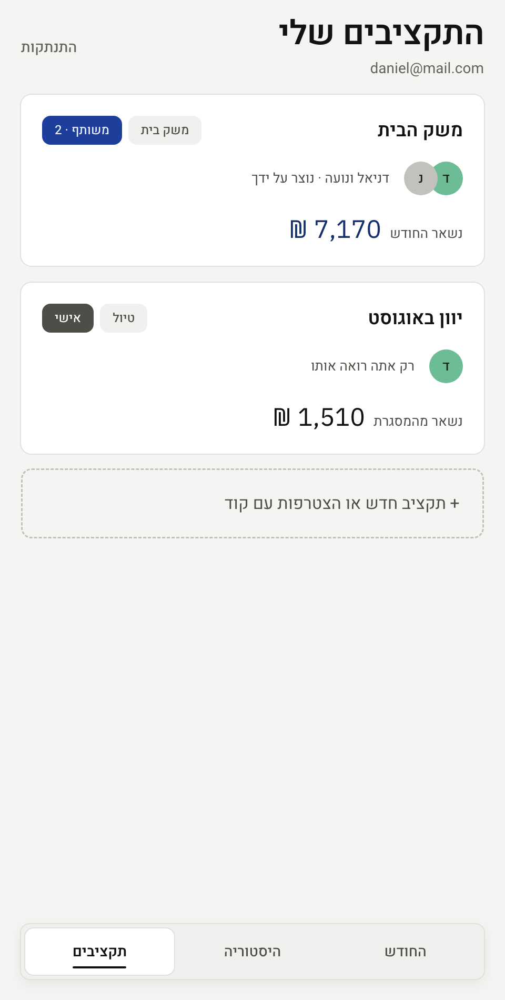
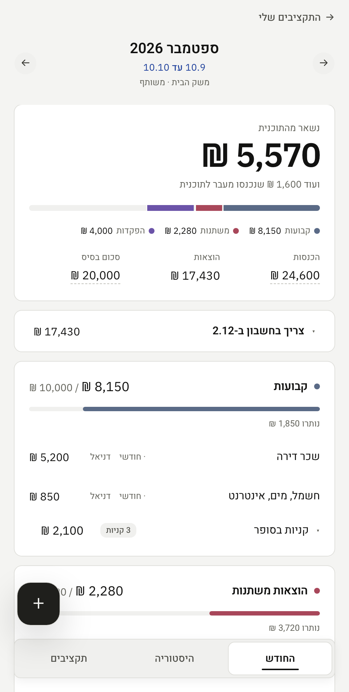
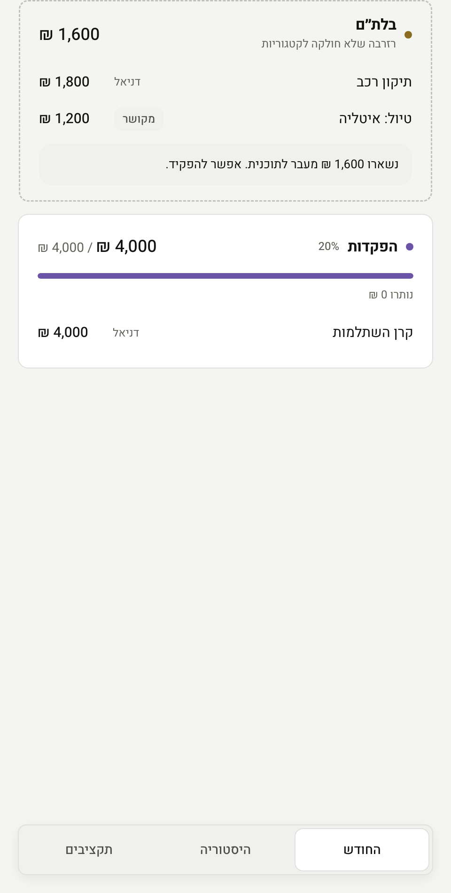
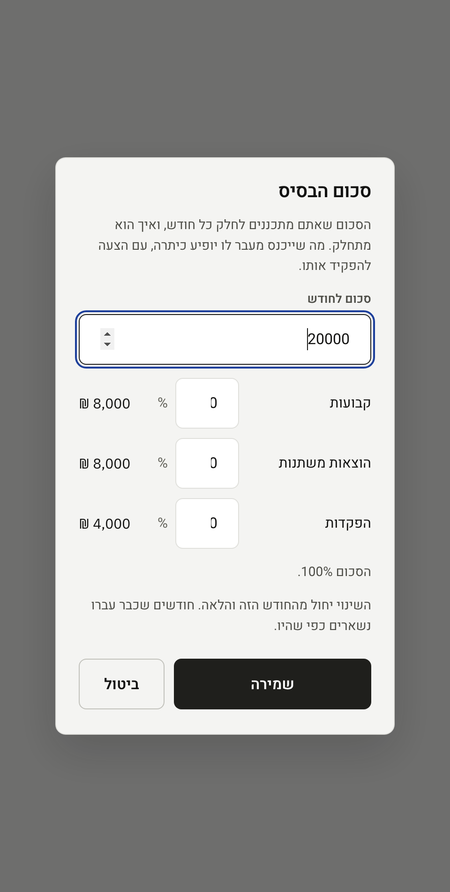
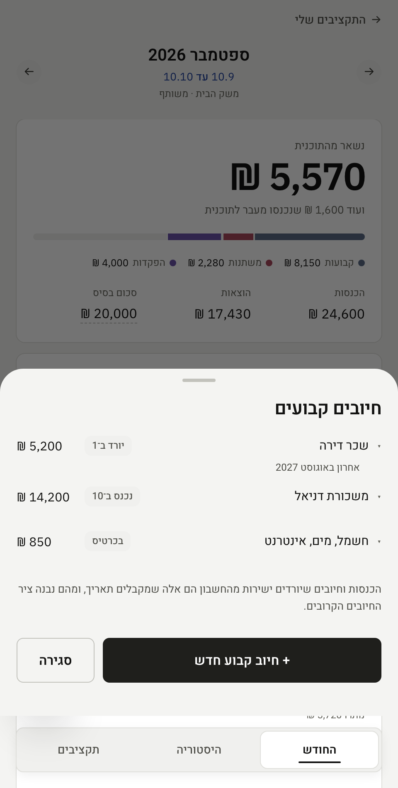
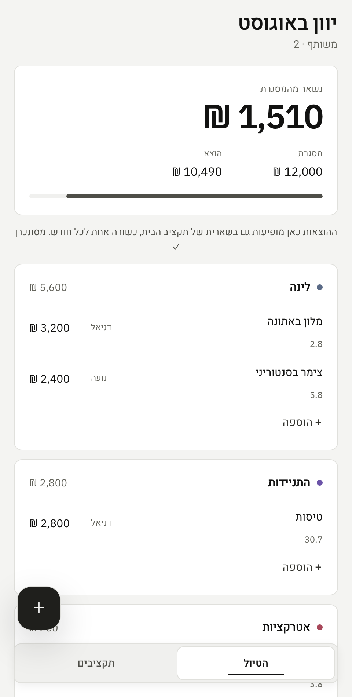
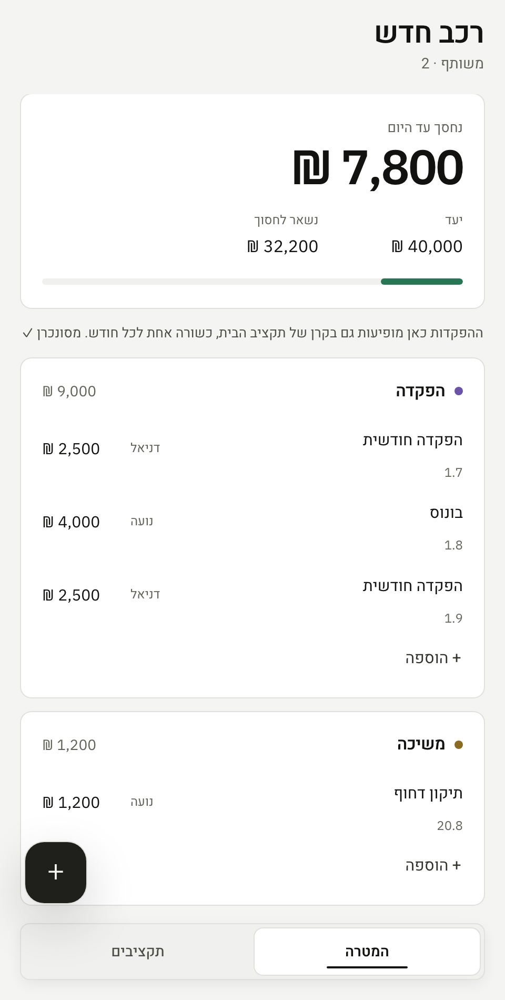
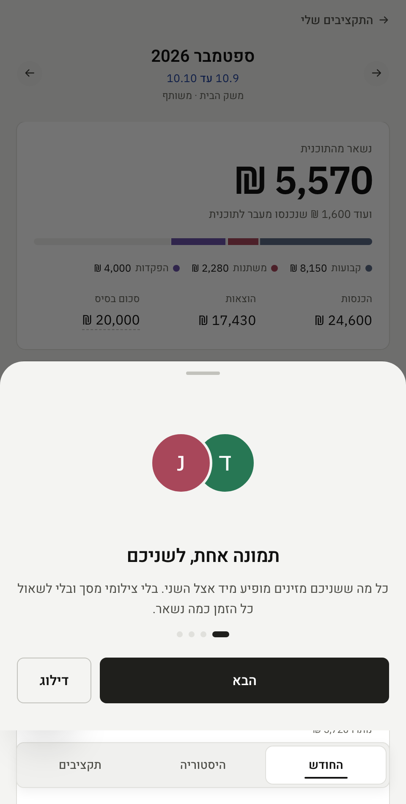
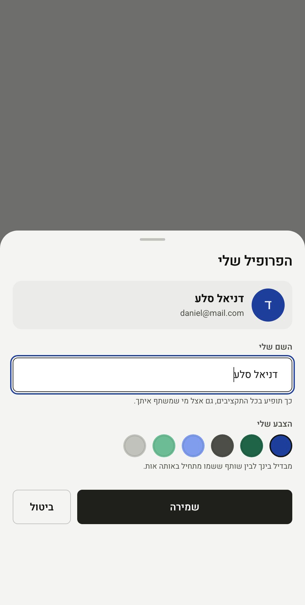

<div align="center">


# BudgetTracker

**A shared monthly budget for two people.**
An installable PWA: no developer account, no app store, no native build.

[](https://budget-tracker-virid-one.vercel.app)


The interface is in Hebrew and right to left throughout.

</div>

---

## Contents

[Screens](#screens) · [What it does](#what-it-does) · [How the money works](#how-the-money-works) ·
[Budget types](#budget-types) · [Data model](#data-model) · [Security](#security) ·
[Notifications](#notifications) · [Running locally](#running-locally) ·
[Deployment](#deployment) · [Project layout](#project-layout)

Two companion documents carry what this one deliberately leaves out:
[PRODUCT.md](PRODUCT.md) is who the app is for and what it is for, and
[DESIGN.md](DESIGN.md) is the visual system and the reasoning behind it.

---

## Screens

<table>
<tr>
<td width="33%"></td>
<td width="33%"></td>
<td width="33%"></td>
</tr>
<tr>
<td align="center"><b>Sign in</b><br/>Email and password, or Google</td>
<td align="center"><b>My budgets</b><br/>Personal or shared, with an invite code</td>
<td align="center"><b>New budget</b><br/>Pick a type, and link a trip to a household</td>
</tr>
<tr>
<td></td>
<td></td>
<td></td>
</tr>
<tr>
<td align="center"><b>The month</b><br/>What is left of the plan, and a target per group</td>
<td align="center"><b>The remainder</b><br/>What is left, what was unplanned, what to deposit</td>
<td align="center"><b>Where a month went</b><br/>Opened from a bar in the history, by sector</td>
</tr>
<tr>
<td></td>
<td></td>
<td></td>
</tr>
<tr>
<td align="center"><b>The base and its split</b><br/>The percentages are the household's own, and past months keep theirs</td>
<td align="center"><b>Standing commitments</b><br/>Every recurring charge: amount, the day it moves, when it ends</td>
<td align="center"><b>A month that will not hold</b><br/>Said mid month, while something can still be done</td>
</tr>
<tr>
<td></td>
<td></td>
<td></td>
</tr>
<tr>
<td align="center"><b>A trip</b><br/>One frame, its own categories, no months</td>
<td align="center"><b>A saving goal</b><br/>A target to fill, deposits and withdrawals</td>
<td align="center"><b>Import a statement</b><br/>The format and the columns are read from the file</td>
</tr>
<tr>
<td></td>
<td></td>
<td></td>
</tr>
<tr>
<td align="center"><b>First run</b><br/>One example carried through four steps</td>
<td align="center"><b>Profile</b><br/>One name and one colour, everywhere</td>
<td></td>
</tr>
</table>

---

## What it does

**Two people, one budget.** Separate sign ins and shared data, with a change on
one phone showing up on the other immediately. Someone joins through an eight
character invite code, single use and valid for a week, with no security rules to
edit. A person can be in several budgets at once, a shared household one and a
personal one, and carries the same name and colour into each.

**Money that repeats.** Tick a box when adding a row and it is created every month
from then on. A lease runs a year and a loan has twelve payments, so a charge can
be given an end, and it stops on time with a warning the month before. Every
standing charge is editable in one place: the amount when rent goes up, the day it
leaves the account, when it ends.

**Getting expenses in.** Type them, import a statement (CSV, XLSX, or a file that
merely claims to be Excel, with both the format and the columns read from the file
itself), or capture one by voice: an iOS Shortcut, or a double tap on the back of
the phone, and "50 shufersal" waits in an inbox at the top of the month for one tap
to approve. The category is guessed from the merchant name through the same sector
table the importer uses. No server and no token, because the browser that opens the
link is already signed in. See [docs/quick-capture.md](docs/quick-capture.md).

**Keeping the month readable.** Rows that belong together collapse into one line
with a running total, so a weekly grocery run does not bury the card. Any row can
be edited in place, including which group it belongs to, so forgetting to tap the
group when entering it is not a reason to delete and start again. When several
rows in a month come from the same shop, grouping one of them offers to take the
others along.

**Knowing where you stand.** The month leads with what is left of the plan, with a
target per group. A dated timeline shows what is about to leave and arrive and how
much has to be in the account to get through it. Mid month the app says when the
month will not hold. Every bar in the history opens that month's breakdown by
sector. On the billing date, a notification summarises the cycle that just closed.

**Living on a phone.** It opens and shows data with no connection and syncs writes
when one returns; the billing date is the 2nd, 10th or 15th, so a month closes when
it actually closes; and every row carries a coloured avatar of whoever entered it.

---

## How the money works

### The base, and the split you choose

Targets are a share of a **base amount** rather than of the whole income, so a
liquid margin stays in the account without being allocated to anything. By default
the base is derived from income:

```
base = floor((income - 1) / 5000) * 5000
```

which is the nearest multiple of 5,000 strictly **below** it. The `- 1` is what
makes an income of exactly 25,000 drop a step to 20,000 rather than allocate every
shekel.

Deriving it has a flaw, though: a month that earned 31,000 raises every target, so
a good month silently permits more spending, which is backwards for a budget where
the plan is meant to lead. So the base can be a number you set instead. Set 20,000
and the targets hold whatever comes in, with everything above it surfacing as the
**remainder** and a prompt to deposit rather than spend it. A set base is still
capped by the income that actually arrived.

The base splits three ways, **50 / 30 / 20** by default: fixed, variable, deposits.
That is a rule of thumb and not a law, so the three percentages are editable beside
the base amount, validated to exactly 100. Any other sum either allocates money that
does not exist or leaves money with no home, and in both cases the targets lie.

**A past month never moves.** Targets are computed rather than stored, so until
`planHistory` existed, today's base and ratios were applied to every month ever
recorded and raising the base would quietly turn an overspent August into a good
one. Each change is now written with the month it takes effect from, and a month
reads the latest record not later than itself. The first change also records what
was in force until then, under the month `0000-00`, so older months resolve to the
old plan. Both members can change it, and the history is capped at 60 records
because it is a field every member can write to.

### What the month screen leads with

**What is left of the plan**: the base minus what the three groups spent. Not
income minus expenses, which counts money above the base as spendable and is the
one thing a chosen base exists to prevent. Unplanned spending comes out of the
remainder rather than the plan, so it is never subtracted twice.

Overspending fixed or variable is marked in red. **Overspending deposits is not**,
because paying in more than the target is the point, and it reads as "beyond
target" instead.

### Saying it mid month

The verdict is said while the month is still running, not after it closes, because
every standing charge is written as a row the moment the month opens: rent,
insurance and both salaries are counted on day one, so the comparison is fair from
the start.

It holds in one direction only. Spending grows, so **this will not hold** is certain
and cannot reverse, while "this will hold" is a forecast and is never said. Two
levels, the same thresholds the end of month summary uses: the plan is broken when
spending passed the base, and the month eats savings when it passed the income.

It stays silent until there is one income entry per member, because in a budget for
two a single salary entered looks exactly like a broken month, and one false alarm
is enough for both people to stop believing the rest.

### Where a month went

Every bar in the history is a button that opens that month's breakdown: a ring by
sector with the figures listed under it, because areas of a circle cannot be
compared by eye.

- **Only money that was chosen is counted**, which is variable spending and the
  unplanned, never the fixed. Rent and the electricity bill are not a decision made
  this month and would drown out everything that was. The user's own classification
  decides it, not the presence of a template.
- **The sector is derived from the name at read time**, through `merchantSector`,
  so the breakdown works on every month already recorded and nothing had to be
  stored for it. A sector's own name counts as a match, not only a shop's.
- **A name with no sector is not swept into "other".** It becomes its own slice
  under the grouping key the month screen already shows it by, so the ring and the
  month agree. Names sharing a first word merge, which turns two "gift for X" rows
  into one "gift" slice. The ring draws the eight largest and collapses the rest
  into one, while the list under it always names every slice.
- **Colour runs by family, not one hue per sector**: eleven hues at one lightness
  cannot be told apart, so there are five families and the sectors inside a family
  differ in lightness. A sector's colour is fixed and never derived from its rank,
  so the same sector looks the same in every month.
- **One sentence above the ring** names the largest sector, and only when it passed
  a third of the variable target. Measured against the plan rather than against the
  other sectors, since in a quiet month the largest sector is still the largest and
  saying so would turn 500 ₪ into a warning.

---

## Budget types

A budget carries a `type`, chosen when it is created and fixed afterwards, because
every entry under it was written against one shape of screen.

**Household** is the monthly budget: income, a base amount, the three targets,
months to navigate between, recurring charges and a history.

**Trip** and **saving goal** are different shapes rather than presets of it. Both
share one amount fixed up front with entries measured against it, and differ in
which direction that amount moves:

|  | Household | Trip | Saving goal |
|---|---|---|---|
| Time | Calendar months | A date on each entry, no months | Same |
| The amount | Income, base derived from it | A frame to spend down | A target to fill up |
| Categories | Fixed in code | Lodging, transport, attractions, dining, shopping, other | Deposit and withdrawal |
| Targets | The split, applied to the base | The frame only | The target only |
| Recurring | Yes | Not meaningful | Not meaningful |
| Rolls up into | - | The remainder | Deposits |

Either can be linked to a household budget. The trip or goal keeps every line of
detail and the household gets **one summary row per month**, locked for editing and
pointing back at its source, so the same money is never counted twice or edited in
two places. Where that row lands follows the meaning: a trip is a planned one off
expense, which is what the remainder is for, and a goal is what the deposits target
exists to hold.

The row id is derived from the source budget and the month, so two devices syncing
at once write to the same document instead of duplicating it. A month that empties
removes its row, deleting the budget removes all of them, and in a goal a
withdrawal reduces what is credited for that month rather than adding to it.

---

## Data model

```
budgets/household_home_bc43zy    name, ownerUid, ownerEmail, type, billingDay, baseAmount,
                                 ratios, planHistory, groupNames, outlookWarned
  members/{uid}                  membership itself; each person creates only their own
  recurring/fixed-rent-k3n9x2    a template a monthly row is derived from
  entries/2026-09_fixed_rent_a7f3   month, date, addedAt, category, budgetGroup, amounts,
                                    groupKey, addedBy
users/{uid}                      profile: display name and avatar colour
users/{uid}/memberships/{id}     private index: which budgets am I in
users/{uid}/devices/{token}      notification registrations, private to that user
invites/K7M2QX4B                 budgetId, active, expiresAt
```

Three decisions worth knowing:

**Entries live under their budget.** The budget is in the path, so it is not a
field and cannot contradict the path. Every query was already scoped to a single
budget, so nothing needed a collection group query or a composite index.

**Document ids are readable.** Type and name for a budget, month and category for
an entry, so a console listing says what each document is without opening it. Ids
derived from content, like a recurring row or a roll up row, keep their derived form
because that is what makes repeat writes idempotent.

**`budgetGroup` is derived from `category`** and never chosen by hand. Income is
`none`, fixed is `fixed`, variable is `leisure`, deposits are `savings`, and the
remainder is `none` so that it stays outside the ratio.

---

## Security

Access is enforced in `firestore.rules` in two layers: membership of a budget, and
field by field validation of every record written.

Invites are implemented entirely in rules, with no Cloud Functions, so the project
stays on the free plan. Someone joining creates a membership document **for
themselves only**, and the rule accepts it only against an invite code that is
valid, unused and unexpired.

```bash
npm run test:rules
```

runs 133 tests against a real Firestore emulator, the adversarial cases included:
joining without a code, with a used, expired or another budget's code, adding
somebody else with a valid code, extending an expiry, taking over ownership,
listing invites, moving a record between budgets, forging `addedBy`, writing
somebody else's profile, listing all users, and planting an email that is not the
one in your own token.

---

## Notifications

On the billing date, when the cycle that just ended is final, every member gets a
notification in one of three versions, because a month ends in three ways: money
left to deposit, spending beyond a target, or spending beyond the income itself.
The date matters, since a summary sent on the 30th would describe a month whose
largest part, the card charges, had not landed yet.

On any other day the same job sends the mid month warning, and only its severe
level. A broken plan stays on screen, being information rather than something worth
interrupting someone for. It is sent **once per month**, guarded by `outlookWarned`,
because the same warning for thirty days running is noise people turn off.

Sending runs from **GitHub Actions** rather than a Cloud Function, again to stay on
the free plan. The job runs daily and decides per budget, in `Asia/Jerusalem`,
whether today is that budget's billing date.

Two one time setup steps:

1. **Web Push key**: Firebase Console → Project settings → Cloud Messaging → Web
   Push certificates → Generate key pair. Add it as `VITE_FIREBASE_VAPID_KEY` in
   `.env.local` and in the Vercel environment variables.
2. **Service account**: Firebase Console → Project settings → Service accounts →
   Generate new private key. Paste the whole JSON as a repository secret named
   `FIREBASE_SERVICE_ACCOUNT`. **That key grants full access to the project. Never
   put it in the code.**

To try it without waiting for the end of the month: GitHub → Actions → run the
workflow with `force` ticked.

On iOS, notifications only work in an app added to the Home Screen. In an ordinary
Safari tab the API does not exist at all, and the interface says so rather than
showing a switch that cannot work.

---

## Running locally

```bash
npm install
cp .env.example .env.local   # fill in from Firebase Console → Project settings → Your apps
npm run dev
```

| Script | What it does |
|---|---|
| `npm run dev` | Development server |
| `npm run build` | Production build |
| `npm run preview` | Serve the build, service worker included |
| `npm test` | Logic, rollup and render tests |
| `npm run test:rules` | Security rules against the emulator (needs Java) |
| `npm run lint` | oxlint, with `no-undef` on |
| `npm run deploy:rules` | Push security rules and indexes to Firestore |
| `npm run nudge` | Run the notification sender locally (needs a service account) |
| `npm run shots` | Recapture every screenshot in `docs/screens/` |

Tests come in three layers, and each exists because something slipped past the
others. **Logic** covers the base amount, the month summary, recurring templates,
grouping and the trip rollup as pure functions. **Rules** run against a real
emulator, since reasoning about Firestore rules by reading them is unreliable.
**Render** mounts every screen, and the whole tree with a signed in user, because a
component that throws while rendering used to pass the entire suite and ship.

The screenshots come from `shots.html`, served only by the dev server and not part
of the build, captured with headless Chrome at 500px wide.

---

## Deployment

**Vercel only**, from `main`, automatically on every push:
[budget-tracker-virid-one.vercel.app](https://budget-tracker-virid-one.vercel.app)

There is deliberately one address. Firebase Hosting once served a second copy, and
two live copies where only one updates by itself is a trap: a fix goes to one
address and is tested on the other, and it looks like nothing worked.

What Vercel does **not** cover is Firestore rules and indexes. After changing
`firestore.rules` or `firestore.indexes.json`:

```bash
npm run deploy:rules
```

### Installing on iPhone

Open the address in **Safari**, the only browser that can install a PWA on iOS,
then Share → Add to Home Screen. It opens full screen with no address bar.

Updates take over as soon as they are deployed, with no confirmation step: when the
running version is broken there is no screen left to confirm from. An installed app
resumes from memory rather than reloading, so it also checks for a new version
whenever it comes back to the foreground.

---

## Project layout

```
src/
  components/    the interface
  context/       AuthContext, BudgetContext
  hooks/         entries, history, recurring, trips, balances
  lib/           model, budgets, groups, merchants, breakdown, recurring, format
  dev/shots.jsx  the fixtures behind the screenshots
  sw.js          service worker: caching and background notifications
  index.css      design tokens
  App.css        component styles
scripts/         the notification sender, and the screenshot capture
tests/           logic, rules and render tests
docs/            screenshots, the import spec, the quick capture guide
firestore.rules  security rules
DESIGN.md        the visual system
PRODUCT.md       who it is for, and what it is for
```
