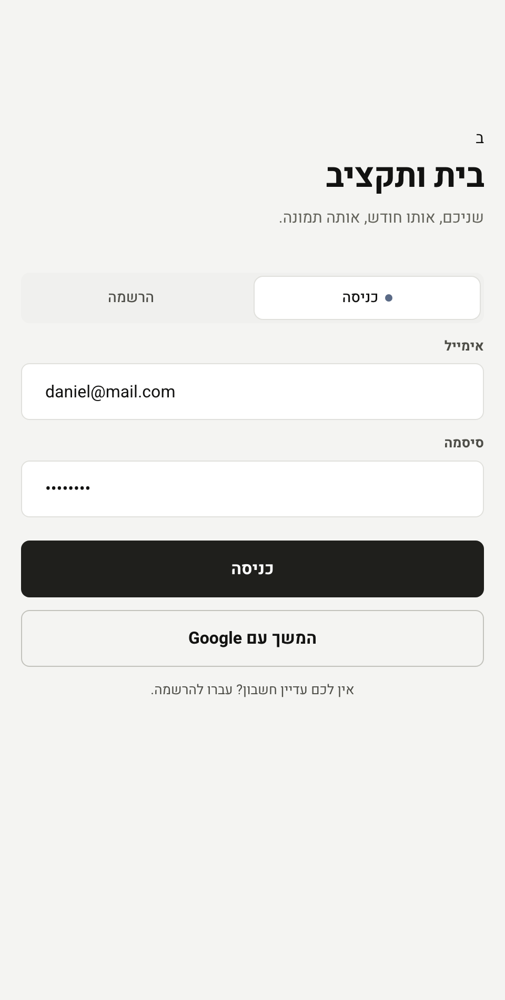
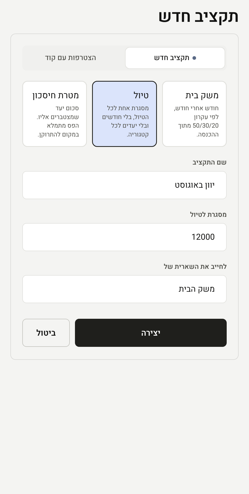
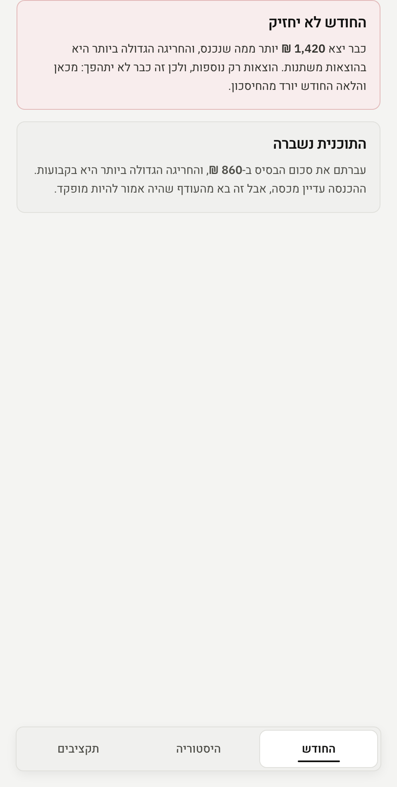
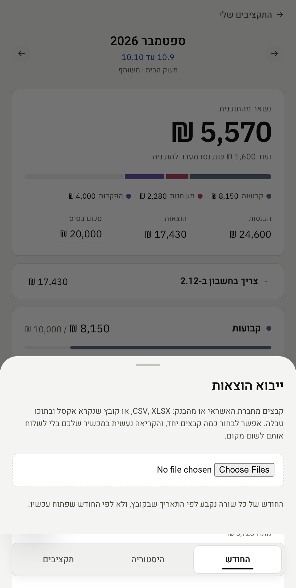
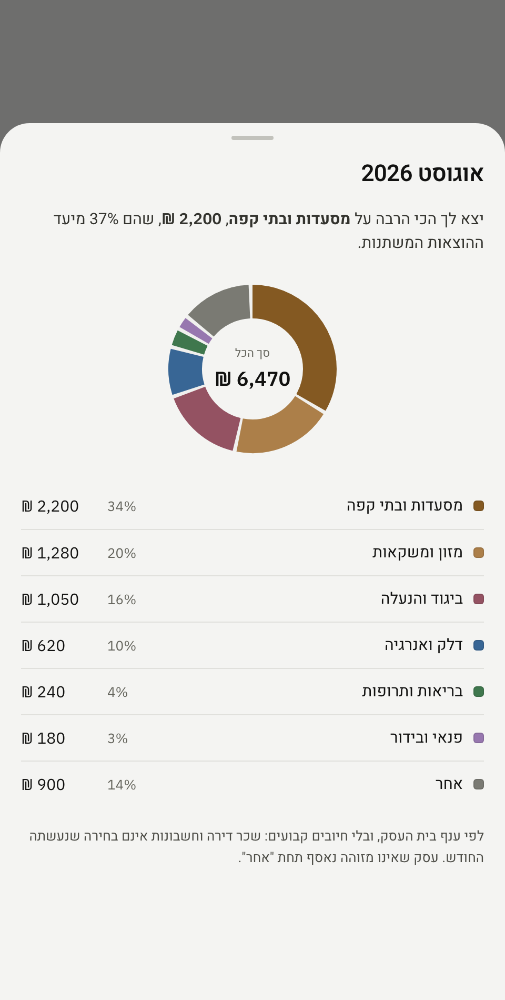

<div align="center">


# BudgetTracker

**A shared budget for two people, built around the 50/30/20 rule.**
An installable PWA. No developer account, no app store, no native build.

[](https://budget-tracker-virid-one.vercel.app)


The interface is in Hebrew and right to left throughout.

</div>

---

## Screens

<table>
<tr>
<td width="33%"></td>
<td width="33%"></td>
<td width="33%"></td>
</tr>
<tr>
<td align="center"><b>Sign in</b><br/>Email and password, or Google</td>
<td align="center"><b>My budgets</b><br/>Personal or shared, with an invite code</td>
<td align="center"><b>New budget</b><br/>Pick a type, and link a trip to a household</td>
</tr>
<tr>
<td></td>
<td></td>
<td></td>
</tr>
<tr>
<td align="center"><b>The month</b><br/>What is left of the plan, and a target per group</td>
<td align="center"><b>A trip</b><br/>One frame, its own categories, no months</td>
<td align="center"><b>A saving goal</b><br/>A target to fill, deposits and withdrawals</td>
</tr>
<tr>
<td></td>
<td></td>
<td></td>
</tr>
<tr>
<td align="center"><b>First run</b><br/>One example carried through four steps</td>
<td align="center"><b>The remainder</b><br/>What is left, what was unplanned, what to deposit</td>
<td align="center"><b>Profile</b><br/>One name and one colour, everywhere</td>
</tr>
<tr>
<td></td>
<td></td>
<td></td>
</tr>
<tr>
<td align="center"><b>Standing commitments</b><br/>Every recurring charge: amount, the day it moves, when it ends</td>
<td align="center"><b>A month that will not hold</b><br/>Said mid month, in two levels, while something can still be done</td>
<td align="center"><b>Import a statement</b><br/>The format and the columns are read from the file</td>
</tr>
<tr>
<td width="33%"></td>
<td></td>
<td></td>
</tr>
<tr>
<td align="center"><b>Where a month went</b><br/>Opened from a bar in the history, by sector, without the standing charges</td>
<td></td>
<td></td>
</tr>
</table>

---

## What it does

| | |
|---|---|
| **One budget, two accounts** | Separate sign ins, shared data. A change shows up on the other phone immediately. |
| **Invite by code** | Eight characters, single use, valid for a week. No editing security rules to add someone. |
| **Several budgets** | A shared household one and a personal one, with different members in each. |
| **Recurring charges** | Tick a box when adding, and the row is created automatically every month. |
| **For a term, not forever** | A lease runs a year and a loan has twelve payments. Set an end and the charge stops on time, with a warning the month before. |
| **Commitments in one place** | Every recurring charge, editable: the amount when rent goes up, the day it leaves the account, when it ends. |
| **Import a statement** | CSV, XLSX, or a file that claims to be Excel and holds a table. The format and the columns are both read from the file itself. |
| **What is about to be charged** | A dated timeline of what leaves and what arrives, and the one figure that matters: how much has to be in the account to get through it. |
| **A base amount you choose** | Set what you plan to divide each month, so a good month does not quietly license more spending. |
| **A real remainder** | What comes in above the base is a category you can spend from, with a prompt to deposit what is left. |
| **Your own billing date** | The 2nd, 10th or 15th. The app opens on the cycle that is running and closes a month when it actually closes. |
| **Grouped rows** | Many small shops under one collapsed line, so one grocery run a week does not bury the card. |
| **Edit in place** | Name, category and amount, without deleting and re-entering. |
| **Trips** | A separate budget shape for a trip, which can charge the household remainder. |
| **Saving goals** | A target to accumulate towards, whose deposits show up in the household's deposits. |
| **Works offline** | Opens and shows data without a connection. Writes sync when it returns. |
| **Who entered what** | A coloured avatar on every row. |
| **Quick capture** | One Shortcut, or a double tap on the back of the phone: say "50 shufersal" and it waits in an inbox at the top of the month for one tap to approve. The category is guessed from the merchant name through the same sector table the importer uses, never from what you classified before. No server and no token, because the browser that opens the link is already signed in. See [docs/quick-capture.md](docs/quick-capture.md). |
| **A month that will not hold** | Said while the month is running, not after it closes, because every standing charge is already a row on day one. Two levels: the plan is broken, or the month is eating savings. Silent until each person's income is in, so a half entered month never raises a false alarm. |
| **Notifications** | On your billing date, what is left to deposit or where you overspent. Mid month, once, only when the month is already past the income. |
| **One profile** | A name and a colour that belong to the person, identical in every budget. |

---

## Budget types

A budget carries a `type`, chosen when it is created and fixed afterwards, because
every entry under it was written against one shape of screen.

### Household

The monthly budget. Income, a computed base amount, and the three targets. Months
to navigate between, recurring charges, and a history view.

### Trip and saving goal

Both are a different shape rather than a preset of the household one. They share
one amount fixed up front and entries measured against it, and differ in which
direction that amount moves:

|  | Household | Trip | Saving goal |
|---|---|---|---|
| Time | Calendar months | A date on each entry, no month to navigate | Same |
| The amount | Income, base derived from it | A frame to spend down | A target to fill up |
| Categories | Four, fixed in code | Lodging, transport, attractions, dining, shopping, other | Deposit and withdrawal |
| Targets | 50/30/20 of the base | The frame only | The target only |
| Recurring | Yes | Not meaningful | Not meaningful |
| Rolls up into | - | The remainder | Deposits |

Either can be linked to a household budget. The trip or goal keeps every line of
detail; the household gets **one summary row per month**, locked for editing and
pointing back at its source, so the same money is never counted twice or edited in
two places.

Where that row lands follows the meaning: a trip is a one off expense that was
planned for, which is what the remainder is for, and a goal is exactly what the
20% deposits target exists to hold.

The row id is derived from the source budget and the month, so two devices syncing
at once write to the same document instead of duplicating it. A month that empties
out removes its row, and deleting the budget removes all of them. In a goal, a
withdrawal reduces what is credited for that month rather than adding to it.

---

## The 50/30/20 rule

The ratio is not taken from the whole income but from a **base amount**, so a
liquid margin stays in the account without being allocated to anything.

```
base = floor((income - 1) / 5000) * 5000
```

The base is the nearest multiple of 5,000 strictly **below** the income:

| Income | Base | Reserve |
|---:|---:|---:|
| 24,000 | 20,000 | 4,000 |
| 26,000 | 25,000 | 1,000 |
| 25,000 | 20,000 | 5,000 |

The third row is the one that is easy to get wrong: an income that is an exact
multiple of 5,000 drops a step, which is what the `- 1` is for.

Targets come out of the base: **50%** fixed, **30%** variable, **20%** deposits.

### Or set the base yourself

Deriving the base from income has a flaw: a month that earned 31,000 raises every
target, so a good month silently permits more spending. That is backwards for a
budget, where the plan is supposed to lead.

So the base can be a number you set. Set 20,000 and the targets stay 10,000 /
6,000 / 4,000 whatever comes in, and everything above the base shows up as the
**remainder**, with a prompt to deposit it rather than spend it. Leave it empty
and the derivation above is used, exactly as before.

A set base is still capped by the actual income: you cannot plan to divide money
that never arrived.

The figure the month screen leads with is **what is left of the plan**: the base
minus what the three groups spent. Not income minus expenses, which counts money
above the base as spendable and is the one thing a chosen base exists to prevent.
Unplanned spending comes out of the remainder rather than the plan, so it is not
subtracted twice, and the remainder is stated under the figure instead of being
folded into it.

Overspending fixed or variable is marked in red. **Overspending deposits is
not**, because paying in more than the target is the point, and it is shown as
"beyond target" instead.

### Saying it mid month

A verdict used to appear only once a month had closed, on the argument that
"you overspent" mid month is a point in time rather than a finding. That argument
does not survive how the app works: every standing charge is written as a row the
moment the month opens, so rent, insurance and both salaries are already counted
on day one and the comparison is fair from the start.

It holds in one direction. Spending only grows, so **this will not hold** is
certain and cannot reverse, while "this will hold" is a forecast and is never
said. Two levels, the same thresholds the end of month summary uses: the plan is
broken when spending passed the base, and the month eats savings when it passed
the income.

It stays silent until there is one income entry per member. Income varies from
month to month, and in a budget for two a single salary entered looks exactly
like a broken month. One false alarm is enough for both people to stop believing
the rest.

With no income the month has no base, every target is zero, and a balance would
read as a large deficit that is not real. Those numbers are suspended until an
income exists, and the screen leads with a prompt to enter one.

### Where a month went

Every bar in the history is a button, and it opens the breakdown of that month:
a ring by sector with the figures listed under it, because areas of a circle
cannot be compared by eye.

Only money that was **chosen** is counted. A row born from a standing template
is excluded, so rent, insurance and the electricity bill do not drown out the
rest; what is left is the spending of that month. The sector comes from the
merchant name at read time, through `merchantSector`, so the breakdown works on
every month already recorded and nothing had to be stored for it. A merchant the
app does not recognise falls under "אחר", which always sorts last.

Above the ring, one sentence names the largest sector, and only when it passed
**a third of the variable target**. The threshold is relative to the plan rather
than to the other sectors: in a quiet month the largest sector is still the
largest, and saying so would turn 500 ₪ into a warning. The ring itself is drawn
every month, unusual or not, because the split is worth seeing either way.

---

## How it looks

The visual system is **נייר ודיו**, paper and ink: white cards on a near neutral
page, separated by a hairline rather than a shadow, with an achromatic interface
where the only colour is information. Category colour appears in exactly three
places, the dot, the progress bar and the summary segment, and one ink blue
accent means "you can act on this" and nothing else. Figures are set in their
own face, tabular, so money reads as measurement.

The confirmed scene is a phone, several times a day, one handed, often in
daylight, which is why **WCAG AA contrast is a requirement here rather than a
courtesy**. One file, `src/index.css`, defines colour for both schemes, and the
neutral ramp inverts rather than swapping: `--color-neutral-100` is always the
surface and `--color-neutral-900` always the ink, so a component written once is
correct in light and dark alike.

It is recorded in [DESIGN.md](DESIGN.md), and the product truth it serves in
[PRODUCT.md](PRODUCT.md).

---

## Data model

```
budgets/household_home_bc43zy    name, ownerUid, ownerEmail, type, billingDay, baseAmount,
                                 groupNames, outlookWarned
  members/{uid}                  membership itself; each person creates only their own
  recurring/fixed-rent-k3n9x2    a template a monthly row is derived from
  entries/2026-09_fixed_rent_a7f3   month, date, addedAt, category, budgetGroup, amounts, addedBy
users/{uid}                      profile: display name and avatar colour
users/{uid}/memberships/{id}     private index: which budgets am I in
users/{uid}/devices/{token}      notification registrations, private to that user
invites/K7M2QX4B                 budgetId, active, expiresAt
```

Three decisions worth knowing:

**Entries live under their budget.** The budget is in the path, so it is not a
field and cannot contradict the path. Every query was already scoped to a single
budget, so nothing needed a collection group query or a composite index.

**Document ids are readable.** Type and name for a budget, month and category for
an entry. A console listing says what each document is without opening it. Ids
derived from content, like a recurring row or a roll up row, keep their derived
form because that is what makes repeat writes idempotent.

**`budgetGroup` is derived from `category`** and never chosen by hand. Income is
`none`, fixed is `fixed`, variable is `leisure`, deposits are `savings`, and the
remainder is `none` so that it stays outside the ratio.

---

## Security

Access is enforced in `firestore.rules` in two layers: membership of a budget,
and field by field validation of every record written.

Invites are implemented entirely in rules, with no Cloud Functions, so the project
stays on the free plan. Someone joining creates a membership document **for
themselves only**, and the rule accepts it only against an invite code that is
valid, unused and unexpired.

```bash
npm run test:rules
```

runs 129 tests against a real Firestore emulator, including the adversarial cases:
joining without a code, a used code, an expired code, a code belonging to another
budget, adding somebody else with a valid code, extending an expiry, taking over
ownership, listing invites, moving a record between budgets, forging `addedBy`,
writing somebody else's profile, listing all users, and planting an email that is
not the one in your own token.

---

## Notifications

On your billing date, when the cycle that just ended is final, every member gets
a notification. It has three versions, because a month ends in three different
ways: money left to deposit, spending beyond a target, or spending beyond the
income itself.

On any other day the same job sends the mid month warning, and only its severe
level: spending has already passed the income. A broken plan stays on screen,
being information rather than something worth interrupting someone for. It is
sent **once per month**, guarded by `outlookWarned` on the budget document,
because the same warning arriving for thirty days running is noise people turn
off.

The date matters. A summary sent on the 30th would describe a month whose largest
part, the card charges, had not landed yet.

Sending runs from **GitHub Actions**, not a Cloud Function, so the project stays on
the free plan. The job runs daily and decides per budget, in `Asia/Jerusalem`,
whether today is that budget's billing date.

Two one time setup steps:

1. **Web Push key**: Firebase Console → Project settings → Cloud Messaging → Web
   Push certificates → Generate key pair. Add it as `VITE_FIREBASE_VAPID_KEY` in
   `.env.local` and in the Vercel environment variables.
2. **Service account**: Firebase Console → Project settings → Service accounts →
   Generate new private key. Paste the whole JSON as a repository secret named
   `FIREBASE_SERVICE_ACCOUNT`. **That key grants full access to the project. Never
   put it in the code.**

To try it without waiting for the end of the month: GitHub → Actions → run the
workflow with `force` ticked.

On iOS notifications only work in an app that has been added to the Home Screen.
In an ordinary Safari tab the API does not exist at all, and the interface says so
rather than showing a switch that cannot work.

---

## Running locally

```bash
npm install
cp .env.example .env.local   # fill in from the Firebase console
npm run dev
```

Values come from Firebase Console → Project settings → Your apps.

| Script | What it does |
|---|---|
| `npm run dev` | Development server |
| `npm run build` | Production build |
| `npm run preview` | Serve the build, service worker included |
| `npm test` | Logic, rollup and render tests |
| `npm run test:rules` | Security rules against the emulator (needs Java) |
| `npm run lint` | oxlint, with `no-undef` on |
| `npm run deploy:rules` | Push security rules and indexes to Firestore |
| `npm run nudge` | Run the notification sender locally (needs a service account) |
| `npm run shots` | Recapture every screenshot in `docs/screens/` |

### Testing

Three layers, and each exists because something slipped past the others:

**Logic** covers the base amount, the month summary, recurring templates and the
trip rollup as pure functions.

**Rules** run against a real emulator, since reasoning about Firestore rules by
reading them is unreliable.

**Render** mounts every screen, and the whole tree with a signed in user. A
component that throws while rendering used to pass the entire suite and ship.

---

## Deployment

**Vercel only**, from `main`, automatically on every push:
[budget-tracker-virid-one.vercel.app](https://budget-tracker-virid-one.vercel.app)

The app was once deployed to Firebase Hosting as well. Two live copies where only
one updates by itself is a trap: a fix goes to one address and gets tested on the
other, and it looks like nothing worked. Firebase Hosting has been removed.

What Vercel does **not** cover is Firestore rules and indexes. After changing
`firestore.rules` or `firestore.indexes.json`:

```bash
npm run deploy:rules
```

---

## Installing on iPhone

Open the address in **Safari**, which is the only browser that can install a PWA
on iOS, then Share → Add to Home Screen. It opens full screen with no address bar.

Updates take over as soon as they are deployed. An update that waits for the user
to confirm is a trap: when the running version is broken there is no screen left to
confirm from.

---

## Project layout

```
src/
  components/    the interface
  context/       AuthContext, BudgetContext
  hooks/         entries, history, recurring, trips, balances
  lib/           model, budgets, trips, recurring, members, format, messaging
  sw.js          service worker: caching and background notifications
  index.css      design tokens
  App.css        component styles
scripts/         the notification sender, and the screenshot capture
tests/           logic, rules and render tests
docs/screens/    the screenshots in this file
firestore.rules  security rules
DESIGN.md        the visual system
PRODUCT.md       who it is for, and what it is for
```

The screenshots come from `shots.html`, which is served only by the dev server and
is not part of the build, captured with headless Chrome at 500px wide.
